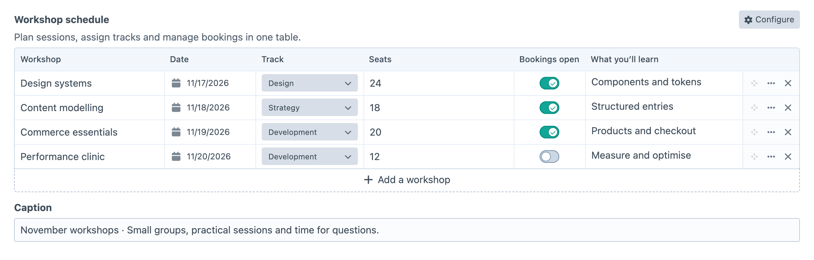
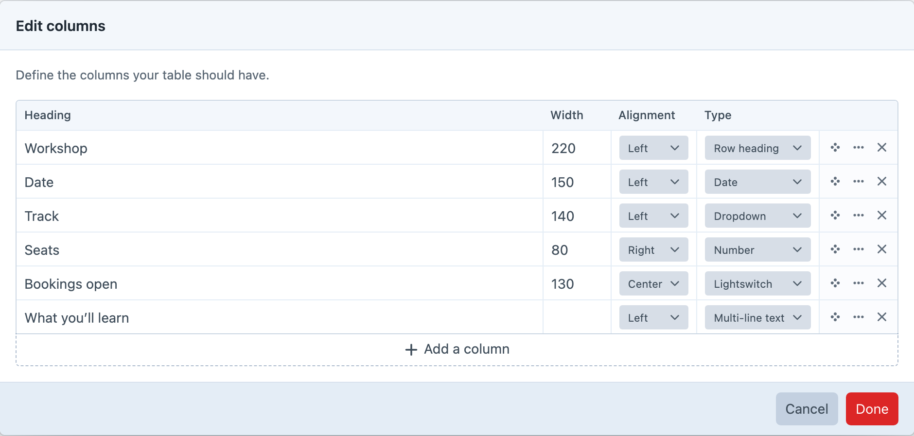

# Field

Use a Table Maker field when editors need to manage both the columns and the content of a table. For example, a workshop schedule can combine dates, tracks, seat counts and booking status. Each entry can have its own headings, rows and optional caption.

## Create a Workshop Schedule

Create a Table Maker field under **Settings → Fields**, name it Workshop Schedule and give it the handle `workshopSchedule`. Add it to an entry type's field layout, then open an entry that uses that layout.

Use **Configure** to define the table. Add Workshop as a **Row heading**, Date as **Date**, Track as **Dropdown**, Seats as **Number**, Bookings open as **Lightswitch** and What you’ll learn as **Multi-line text**. A row heading identifies the rest of its row: the generated HTML uses a `<th scope="row">` cell for each workshop name.

Define Design, Development and Strategy as the Track options, then confirm the column changes. Add sessions such as Design systems and Content modelling, enter their dates and seat counts, and turn bookings on for the available sessions. Save the entry and reopen it to check the headings and values. [Rendering Tables](docs:template-guides/rendering-tables) shows how to display the schedule on your site.

## Field Settings

Enable **Enable Width Column** and **Enable Alignment Column** when editors should control those properties for each column. Width and alignment affect generated table markup; your site's CSS still controls its overall appearance. Turning these controls off preserves the stored widths and alignment.

Use **Configure Button Position** to place the column editor action in the field header or the table's actions header. **Automatic** uses the field header when Craft displays one and the table actions header when the field label is hidden, including label-free Matrix block layouts.

Turn on **Enable Caption** when each table needs a descriptive title, such as “Monthly plans”. You can set its label, instructions and placeholder on the field. The caption appears below the editing grid and is available to Twig and GraphQL. Turning off the input does not remove a stored caption: it still renders, and editors can change it by turning the input back on.

Use **Allowed Column Types** to limit the choices in **Configure**. For this schedule, allow Row heading, Date, Dropdown, Number, Lightswitch and Multi-line text. Choose **All** to make every built-in type available. Changing this setting preserves existing columns and their values. An existing column keeps its current type as a choice; new columns and type changes use the allowed choices.

**Rich text** is available as a column choice only when CKEditor 5.0 or later is installed and enabled. Rich-text cells show a compact formatted preview so paragraphs, emphasis, links and lists remain distinguishable from plain multiline text. By default, selecting that preview opens a focused modal editor with bold, italic, link and list controls. The field setting **Rich Text Toolbar** chooses which formatting buttons editors see, from bold, italic, underline, strikethrough, subscript, superscript, inline code, links, bulleted lists and numbered lists; undo and redo are always available. Saved HTML keeps every format the toolbar can offer, so removing a button only changes the editor and never strips existing content. The field setting **Rich Text Editing Mode** can instead opt a simple table into inline editing; only the active cell creates an editor, and its row expands while it is being edited. Modal editing remains recommended for tables with several columns. **Rich Text Link Types** controls whether editors can select Entries, Categories and Assets as link targets; standard URL links remain available. Element links retain Craft reference tags so generated table HTML follows later URI changes. If CKEditor is disabled, uninstalled or older than version 5.0, existing rich-text columns and their content are preserved and the cells fall back to raw HTML textareas until a supported version is available again.

Set **Min Rows**, **Max Rows**, **Min Columns** or **Max Columns** when the design requires bounds. For example, a minimum of two columns keeps a plan name and price together, while a maximum of four prevents a comparison table from growing too wide. **Add Row Label** lets you give the add action a name suited to the content, such as “Add a plan”.

Tables keep at least one column, so **Max Columns** must be at least 1 when set. Leave a maximum blank for no upper limit. A table can have no content rows; use **Min Rows** when rows are required.

### Column Types

Choose a type according to the value editors need to enter. Text types suit labels and descriptions; Number, Date and Time provide inputs for those values. Number, Email, URL and Color values are validated when the element is saved. Checkbox and Lightswitch suit yes/no information.

For a fixed choice, add a **Dropdown** column and define its option labels and values in **Configure**. For example, Monthly and Yearly labels could store `monthly` and `yearly`. Templates receive the stored value, so account for that when building custom output.

The handles below identify the types in Twig and GraphQL:

| Handle | Label |
| --- | --- |
| `checkbox` | Checkbox |
| `color` | Color |
| `date` | Date |
| `select` | Dropdown |
| `email` | Email |
| `heading` | Row heading |
| `lightswitch` | Lightswitch |
| `multiline` | Multi-line text |
| `number` | Number |
| `richtext` | Rich text (requires CKEditor 5.0+) |
| `singleline` | Single-line text |
| `time` | Time |
| `url` | URL |

## Editing Content

Use **Configure** to add, reorder or rename columns and change their types. Changing a type can change how existing values are interpreted, so check the affected cells before saving. Deleting a column asks for confirmation because it removes that column's content.

To bring in spreadsheet data, copy the cells and paste into the first target cell in the table. Table Maker fills neighbouring cells and adds rows within the field's maximum row limit. Create the destination columns first, then check dates, dropdown choices and other typed values after pasting.

Use **Insert row above / below** in a row's actions menu when you need to insert a plan between existing rows. Save the entry after editing, then compare the public table with the editing grid. For an application that reads or writes the table through an API, follow [GraphQL Queries](docs:graphql/queries).
